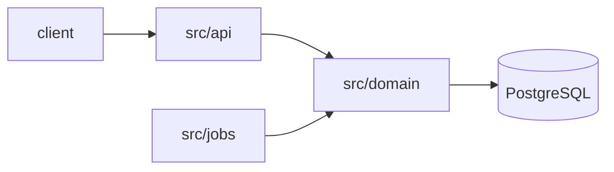

# Codebase Tour Skill

Build a mental map of a repository fast, from evidence in the repo rather than guesses. This skill reads; it doesn't change code. Mark what you **confirmed** (read in a file or ran) and what you **inferred** (from names or structure).

## When Invoked

1. **Ask depth and focus**:
   - **Quick** (one screen, ~5 minutes of reading) or **deep** (full tour).
   - Whole repo, or one area ("the API", `packages/web`)?
   - The reader's goal, if any ("fix a bug in billing", "add an endpoint") - it shapes the reading list.
2. **Gather facts** with the steps below. Read files rather than guessing from names.
3. **Present the tour** in chat using the Output format.
4. **Offer** to save it as `ONBOARDING.md` (or another path), with an optional Mermaid diagram. Ask before writing; if the file exists, show the diff.
5. **Offer follow-ups**: explain a module in depth, or trace why a piece of code looks the way it does with the code-history skill.

## Steps

### 1. Identity

- Read `README*`, and if present `AGENTS.md`, `CLAUDE.md`, `CONTRIBUTING*`, `docs/` index, `ARCHITECTURE*`, `LICENSE`.
- History at a glance:

  ```bash
  git log --reverse --format='%ad %s' --date=short | head -1    # first commit
  git log -1 --format='%ad %s' --date=short                       # latest commit
  git rev-list --count HEAD                                       # number of commits
  git shortlog -sn --no-merges HEAD | head -5                     # main contributors
  ```

### 2. Languages and size

Prefer a line counter; fall back to counting extensions:

```bash
scc --no-cocomo --sort code .        # or: tokei --sort code
git ls-files | sed -n 's/.*\.\([^./]*\)$/\1/p' | sort | uniq -c | sort -rn | head -15   # fallback
```

Both respect `.gitignore` (scc) or only list tracked files (git). Exclude vendored and generated code from conclusions.

### 3. Stack and commands

Find the manifests and read their scripts. Report the real **build / test / run / lint** commands, copied from the files:

| File | Look at |
|------|---------|
| `package.json` (+ lockfile → npm/pnpm/yarn/bun) | `scripts`, `main`/`bin`/`exports`, `workspaces`, key dependencies |
| `pyproject.toml`, `setup.cfg`, `requirements*.txt` | build backend, `[project.scripts]`, tool configs (pytest, ruff, mypy) |
| `Cargo.toml`, `go.mod` | crates/modules, workspace members, binaries |
| `CMakeLists.txt`, `meson.build`, `Makefile`, `justfile`, `Taskfile.yml` | targets, how tests are run |
| `Dockerfile`, `docker-compose*.yml` | runtime, services the app needs (DB, cache, queue) |
| `.github/workflows/*`, `.gitlab-ci.yml` | what CI actually runs - the most reliable list of commands |
| `.env.example`, `config/` | required configuration and secrets (names only) |

Don't run build or test commands unless the user asks; when you do, report the result.

### 4. Directory map

```bash
git ls-files | awk -F/ '{print (NF>1 ? $1"/" : $0)}' | sort | uniq -c | sort -rn        # top level, with file counts
git ls-files | awk -F/ 'NF>2{print $1"/"$2"/"} NF==2{print $1"/"$2}' | sort -u            # two levels deep
```

Give each important directory a one-line purpose, from its contents (and README/index files inside it).

### 5. Entry points

Where execution starts. Search for the patterns of the languages present:

```bash
rg -n --no-heading \
  -e '^if __name__ == .__main__.' -e '^func main\(' -e '^(int|auto) main\(' -e 'fn main\(' \
  -e 'public static void main' -e 'createServer\(|\.listen\(' -e 'app = (FastAPI|Flask)\(' \
  {paths}
```

Also: `bin`/`main`/`exports` in `package.json`, `[project.scripts]`, `cmd/*/main.go`, CLI argument parsers, route/handler registration, job schedulers, and the Dockerfile `CMD`/`ENTRYPOINT`.

### 6. Core modules

Rank modules by evidence, not size alone:

- **Referenced most** - how many files import them (e.g. `rg -l "from app.billing|import billing"`).
- **Changed most** - `git log --since='12 months ago' --name-only --format= | grep -v '^$' | sort | uniq -c | sort -rn | head -15`.
  This count doesn't follow renames; for a moved file use `git log --follow -- {file}`.
- **Largest / most complex** - from step 2 (scc's `Complexity` column) or lizard if installed.

A module high on several lists is central; name 3-7 of them with what they do.

### 7. Conventions

From the docs and config read so far: code style and linters, test layout and naming, branch and commit conventions (`git log --oneline -20`), error handling and logging patterns, anything `AGENTS.md`/`CONTRIBUTING` insists on.

### 8. Reading list

An ordered list of 5-10 files that teach the codebase fastest: usually the README, a manifest, one entry point, the 2-3 central modules, one representative test. Tailor it to the reader's goal from step 1.

## Output

```markdown
# {Project} - codebase tour

**What it is:** one or two sentences. **Status:** first commit 2023-03, 1,204 commits, last change 2026-10-30; main contributors …

## Stack
- Languages: TypeScript 68% (41k lines), SQL 12%, … (scc)
- Runtime / frameworks: Node 22, Fastify, Prisma, PostgreSQL (docker-compose)

## Commands (from package.json and CI)
| Task | Command |
|------|---------|
| Install | `pnpm install` |
| Test | `pnpm test` (vitest) |
| Run | `pnpm dev` (needs `DATABASE_URL`, see `.env.example`) |

## Map
| Path | Purpose |
|------|---------|
| `src/api/` | HTTP routes (Fastify plugins), one file per resource |
| `src/domain/` | Business logic, no I/O |

## Entry points
- `src/server.ts` - starts the HTTP server (confirmed)
- `src/jobs/worker.ts` - background queue worker (inferred from name and `package.json` script `worker`)

## Core modules
1. `src/domain/billing/` - pricing and invoices; imported by 23 files, 41 changes in 12 months

## Conventions
- …

## Read these first
1. `README.md` - setup
2. `src/server.ts` - how requests enter
3. …

## Open questions
- Things you couldn't determine from the repo.
```

Optional diagram for ONBOARDING.md - only boxes and arrows you can justify from imports or config:



## Install

```bash
# scc (line counts, optional)
brew install scc                         # or: go install github.com/boyter/scc/v3@latest
# tokei (alternative)
brew install tokei                       # or: cargo install tokei
# ripgrep (search)
sudo apt install ripgrep                 # or: brew install ripgrep
```
